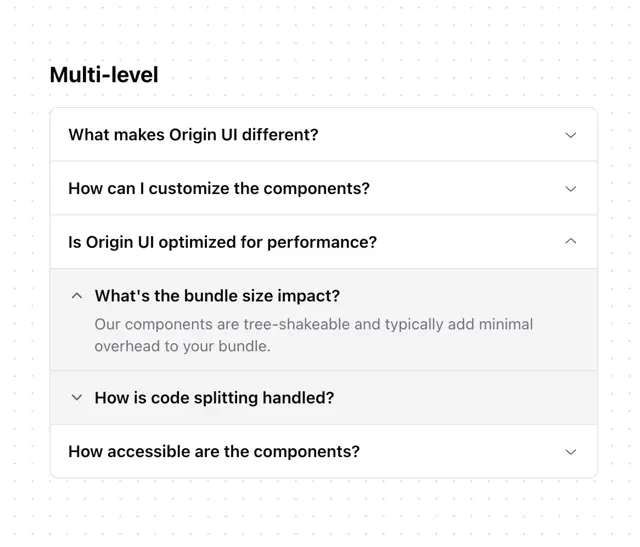

# Bordered FAQ accordion with nested sub-questions in a grey inset, on a dotted white ground

**Discipline:** web ·  · **Design style:** Minimalist
**Tags:** component, accordion, faq, white, dotted, nested, minimal, ui-kit

## What it is
A white component card titled 'Multi-level' with six question rows separated by hairlines and chevrons, where one open row reveals a nested question list in a grey inset with its own chevrons and a short answer.

## What it means
Clear and quiet; grey insets show hierarchy without extra colour.

## Techniques
- Nest sub-accordions inside an open item.
- Tint the nested area grey.
- Use chevrons that flip when open.
- Separate rows with hairlines.

## Best for
- FAQ and documentation components
- UI kit showcases
- Minimal interfaces

## Vocabulary
- **Accordion** — A list of items that expand and collapse.
- **Nested accordion** — An accordion inside an open item.
- **Grey inset** — A tinted area marking a sub-level.
- **Chevron toggle** — An arrow icon showing open or closed.
