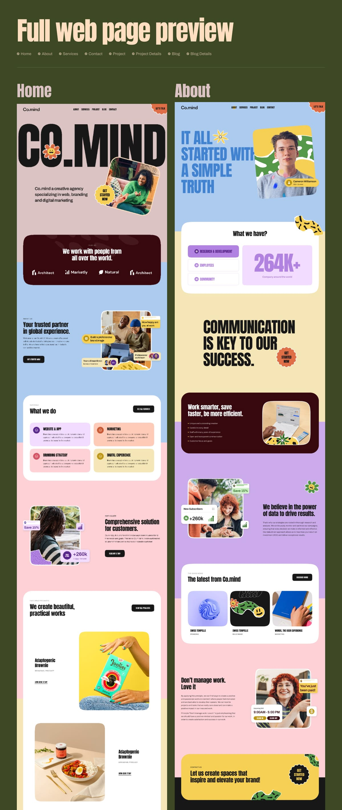

# Agency pages in pink, blue, lilac and butter yellow with giant CO.MIND wordmark, flower mascot and squiggle stickers

**Discipline:** web ·  · **Design style:** Playful & Illustrated
**Tags:** agency, multicolour, pastel, condensed-type, mascot, blob-stickers, rounded-cards, long-scroll

## What it is
Two tall page previews on olive green with a cream condensed title. The pages use full-width pastel bands, a huge black 'CO.MIND' wordmark with a smiling flower, photos in tilted rounded frames, white rounded feature cards with tinted service tiles, a giant lilac '264K+' stat, dark maroon feature panels, orange sticker badges and green squiggle stickers.

## What it means
Joyful and confident; colourful bands and stickers make an agency feel human.

## Techniques
- Alternate pastel full-width colour bands.
- Use a heavy condensed wordmark with a mascot inside.
- Tilt photo frames and add sticker squiggles.
- Contrast pastel with a dark maroon panel.

## Best for
- Creative agencies
- Multi-colour playful brands
- Full site design previews

## Vocabulary
- **Colour band** — A full-width section in one pastel.
- **Sticker badge** — A small rounded shape with a call to action.
- **Flower mascot** — A cartoon flower face used as a brand character.
- **Tilted frame** — A photo frame rotated a few degrees.
