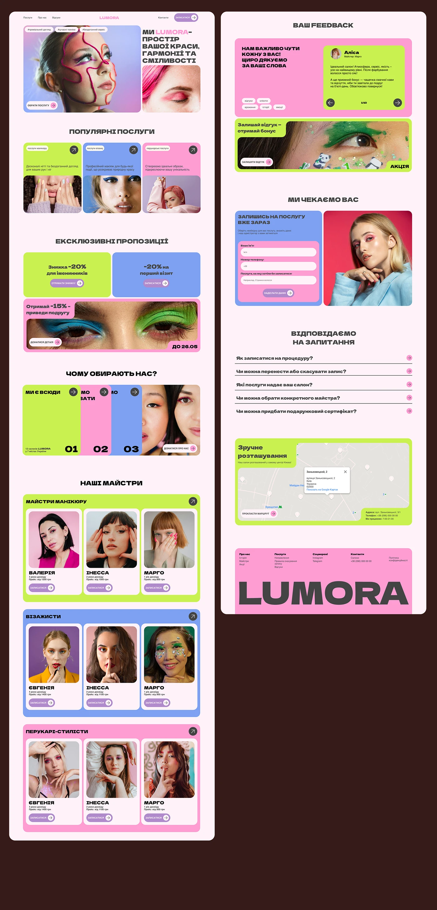

# Beauty-salon site in pink, lime and periwinkle bands with photo cards and giant closing wordmark

**Discipline:** web ·  · **Design style:** Geometric & Bauhaus
**Tags:** beauty, salon, pink, lime, periwinkle, cards, bold-caps, cyrillic

## What it is
Two page columns of a salon site: hero with a face painted with yarn lines and an uppercase headline, service cards in lime, blue and pink, offer tiles, three numbered colour strips, master profile cards grouped by coloured sections, feedback with lime quote card, a booking form on periwinkle with a portrait, an FAQ list, a lime map card and a pink footer with a giant black 'LUMORA'.

## What it means
Energetic and youthful; saturated colour blocks mirror vivid makeup.

## Techniques
- Assign each section its own saturated colour.
- Use rounded cards with photos and round arrow buttons.
- Close with a giant wordmark.
- Use heavy extended uppercase headings.

## Best for
- Beauty and salon sites
- Colour-block web design
- Service lists with staff cards

## Vocabulary
- **Colour-coded section** — Each section in a distinct brand colour.
- **Master card** — A staff profile card.
- **Arrow button** — A small circular arrow action.
- **Giant footer name** — An oversized brand name at the bottom.
