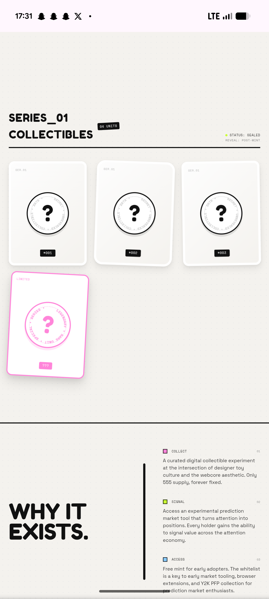

# Mystery Collectible Cards and Manifesto

**Discipline:** web · **Design type:** Landing page sections
**Tags:** collectibles, cards, question-mark, pink, manifesto, monospace, tilted

## What it is
A mobile page section titled 'SERIES_01 COLLECTIBLES' with a unit tag and status text, three tilted white cards showing a circled question mark with circular text, a fourth pink limited card, then a giant 'WHY IT EXISTS.' heading beside a vertical rule and three numbered points with pink, lime and blue squares.

## What it means
Sealed mystery cards create curiosity, and coloured square bullets tie the manifesto to the palette.

## Techniques
- Tilted cards with a circular text seal
- One pink card as the rare item
- Heavy heading beside a thick vertical rule
- Coloured square markers for list items
- Monospace metadata labels

## Best for
- Collectible reveal sections
- Manifesto and why-us blocks
- Mystery-box visuals

## Vocabulary
- **Circular text seal** — A ring of text around a central symbol.
- **Manifesto block** — A short numbered statement of purpose.
- **Vertical rule** — A thick line separating a heading from its content.
