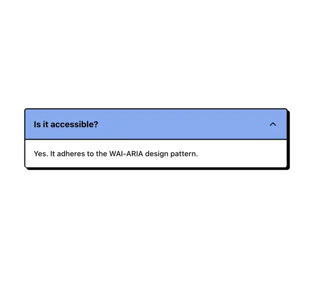

# Single open accordion with a cornflower blue header, black outline and hard offset shadow, asking 'Is it accessible?'

**Discipline:** web · **Design type:** UI components
**Tags:** component, accordion, neo-brutalism, blue, hard-shadow, black-outline, faq, ui-kit

## What it is
A white frame with one accordion item: a cornflower blue header bar with a bold question and an up chevron, a white body with a one-line answer, a thick black outline and a solid black shadow at the bottom right.

## What it means
Bold and tactile; thick outlines and a hard shadow make a small component feel like a sticker.

## Techniques
- Use a coloured header and white body.
- Outline in thick black.
- Add a hard offset shadow.
- Keep type bold and simple.

## Best for
- Neo-brutalist component libraries
- Playful FAQ sections
- Bold outlined UI

## Vocabulary
- **Hard offset shadow** — A solid unblurred shadow beside an element.
- **Coloured header** — An accordion title bar filled with a colour.
- **Black keyline** — A thick black outline around a component.
- **Neo-brutalism** — A style of thick borders, hard shadows and flat colour.
