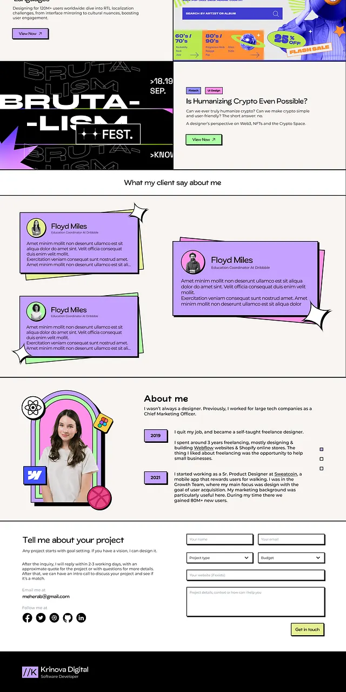

# Neo-brutalist designer portfolio with offset shadows and stickers

**Discipline:** web · **Design type:** Portfolio site
**Tags:** portfolio, neo-brutalism, lilac, offset-shadow, stickers, cream-background, testimonials, contact-form

## What it is
A long portfolio page on cream. Sections include project banners, testimonial cards in lilac with black borders and offset pastel layers, sparkle-star stickers, an About block with an arched sticker portrait and tool badges, a timeline, and a contact form with hard-shadowed fields.

## What it means
Energetic, confident and a bit cheeky: it feels like a personal brand with real personality, not a template.

## Techniques
- Give every card a thick black outline and a hard offset shadow so it reads as a physical sticker.
- Stack two coloured sheets behind a card at slight angles to make it look like a pile of notes.
- Add small four-point sparkle shapes at card corners as playful punctuation.
- Frame the portrait in a layered arch with tool logos as stickers around it.
- Keep the base cream and black so lilac, mint, pink and yellow accents can be loud.

## Best for
- Freelance designer and developer portfolios
- Creative studios that want a playful voice
- Young brands and community sites

## Vocabulary
- **Neo-brutalism** — A web style with thick borders, hard shadows, flat bright colour and raw layout.
- **Offset shadow** — A solid, unblurred shadow displaced to one side of an element.
- **Sticker badge** — A small icon or shape that appears stuck onto the layout.
- **Layered card** — A card with coloured sheets peeking out behind it.
