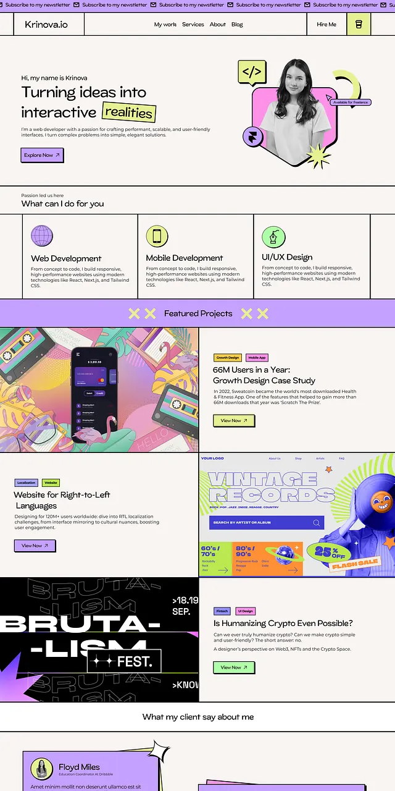

# Cream and lilac developer portfolio with a marquee, sticker portrait, bordered service cells and project tiles

**Discipline:** web · **Design type:** Portfolio site
**Tags:** portfolio, neo-brutalism, lilac, cream, lime, marquee, grid-lines, project-tiles

## What it is
A tall page with a newsletter marquee strip, a top nav with black rules, a hero 'Turning ideas into interactive realities' with a lime highlight and a lilac button beside a pink-hex portrait with tool stickers, three bordered service cells with circle icons, a lilac 'Featured Projects' band, alternating project rows with tags and buttons, and a testimonial with a lilac card.

## What it means
Playful and structured; black grid lines and sticker accents give personality.

## Techniques
- Divide the page with black hairline grid lines.
- Highlight one word with a lime block.
- Use a marquee strip at the top.
- Alternate image and text rows for projects.

## Best for
- Developer and designer portfolios
- Neo-brutalist sites
- Project showcase pages

## Vocabulary
- **Marquee strip** — A scrolling text band.
- **Bordered cell** — A grid cell divided by black lines.
- **Lime highlight** — A word on a lime block.
- **Project row** — An image and text pair for one project.
