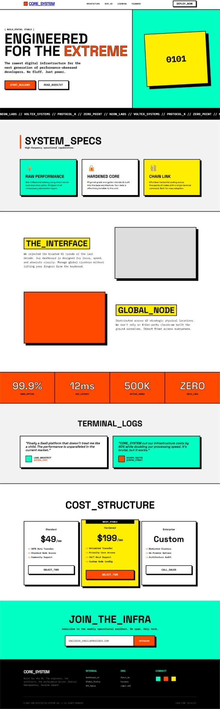

# Long neo-brutalist infrastructure site in mint, yellow, orange and black with monospace headings, hard-shadow cards and ticker

**Discipline:** web · **Design type:** SaaS landing page
**Tags:** neo-brutalism, mint, yellow, orange, monospace, hard-shadow, ticker, pricing

## What it is
A tall page with a black-outlined nav, hero 'ENGINEERED FOR THE EXTREME' with an orange keyword and a mint panel with a tilted yellow square '0101', a black scrolling ticker, three hard-shadow spec cards, highlighted headings, orange and grey blocks, an orange stat strip, testimonial cards, three-tier pricing with a yellow middle plan, a mint email footer and a black footer.

## What it means
Loud and playful; hard shadows, bright fills and underscore headings feel like a developer zine.

## Techniques
- Give every card a thick border and hard offset shadow.
- Use underscore headings in monospace.
- Alternate mint, yellow and orange blocks.
- Highlight the recommended plan in yellow.

## Best for
- Developer tools and infra brands
- Neo-brutalist sites
- Bright block palettes

## Vocabulary
- **Hard offset shadow** — A solid unblurred shadow beside an element.
- **Underscore heading** — A heading with underscores between words.
- **Ticker strip** — A scrolling band of text.
- **Block palette** — Flat bright fills used as sections.
