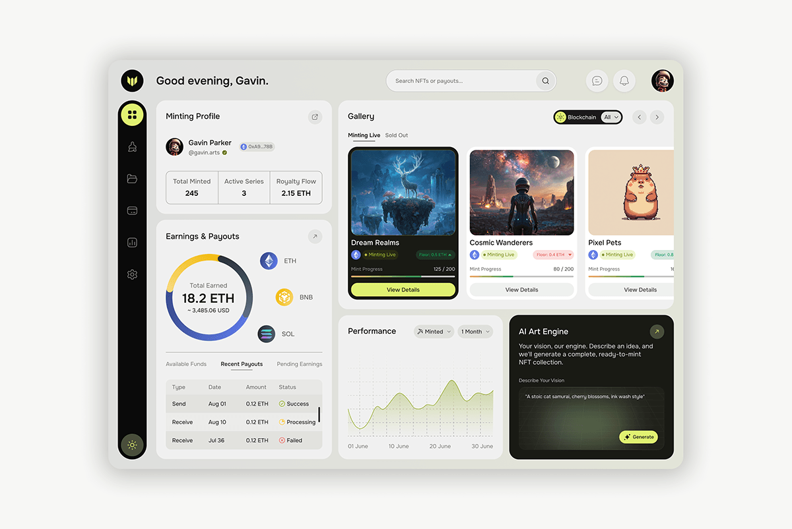

# NFT Creator Dashboard with Lime Accents

**Discipline:** web ·  · **Design style:** Corporate & Clean-Tech
**Tags:** dashboard, nft, lime, black, beige, gallery, charts, ai

## What it is
A beige rounded dashboard with a black icon rail with a lime active item, a minting profile, earnings donut with coin icons and a payouts table, a gallery of NFT cards with a black active card and lime button, a performance line chart and a dark AI Art Engine card with a lime Generate pill.

## What it means
Lime marks what is active on black and beige, and the mix of card types keeps a dense dashboard readable.

## Techniques
- Lime as the active-state colour on a black rail
- One black card among white gallery cards
- Donut chart with coin icons
- Dark AI card as a feature block
- Warm beige shell with white panels

## Best for
- Creator and NFT dashboards
- Dashboards with a lime accent
- Gallery plus analytics layouts

## Vocabulary
- **Icon rail** — A narrow vertical bar of navigation icons.
- **Active card** — The card styled differently to show selection.
- **Feature block** — A dark tile promoting a special tool.
