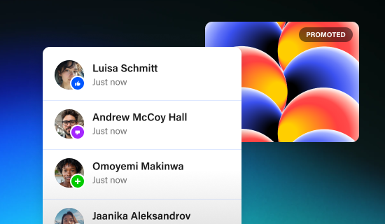

# White notification list with avatars, coloured reaction badges and 'Just now' over a red-orange-blue sphere promo card with a PROMOTED tag, on a blue-teal glow

**Discipline:** web · **Design type:** Feature illustration
**Tags:** feature-illustration, notifications, avatars, promoted, gradient-spheres, blue, glow, cards

## What it is
A dark navy background with a blue and teal glow at the bottom left, a white notification card with rounded avatars each with a small coloured badge (like, message, plus), bold names and grey 'Just now', and behind it a gradient card of overlapping red, orange and blue spheres with a translucent 'PROMOTED' pill.

## What it means
Lively and clear; stacked white and gradient cards show engagement and promotion in one image.

## Techniques
- Stack a white list over a gradient card.
- Add small reaction badges on avatars.
- Use overlapping gradient spheres.
- Glow the background.

## Best for
- Social and notification feature graphics
- Promotional product illustrations
- Card stack visuals

## Vocabulary
- **Reaction badge** — A small coloured icon on an avatar.
- **Promoted tag** — A pill marking sponsored content.
- **Gradient spheres** — Overlapping 3D-like balls of colour.
- **Card stack** — Cards layered to show depth.
