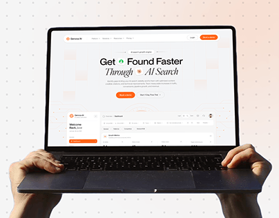

# AI Search SaaS on a Held Laptop

**Discipline:** web · **Design type:** Device mockup scene
**Tags:** laptop, hands, orange, dots, ai-search, saas, cover

## What it is
A cover with two hands lifting a laptop that shows a pale SaaS hero, 'Get Found Faster Through AI Search', with orange accents and a dashboard below, on a soft dotted background with a peach glow.

## What it means
Hands holding the laptop make it feel tangible and easy to grasp, and the dot grid adds a light technical note.

## Techniques
- Hands gripping the laptop from below
- Dot-grid backdrop with a peach corner glow
- Italic serif word inside a sans headline
- Orange as the single accent
- Dashboard cropped under the hero

## Best for
- SaaS website case studies
- Marketing and SEO tools
- Light, friendly product covers

## Vocabulary
- **Dot grid** — A regular field of small dots used as a subtle background.
- **Held device** — A device shown in someone's hands.
- **Serif accent** — An italic serif word in an otherwise sans headline.
