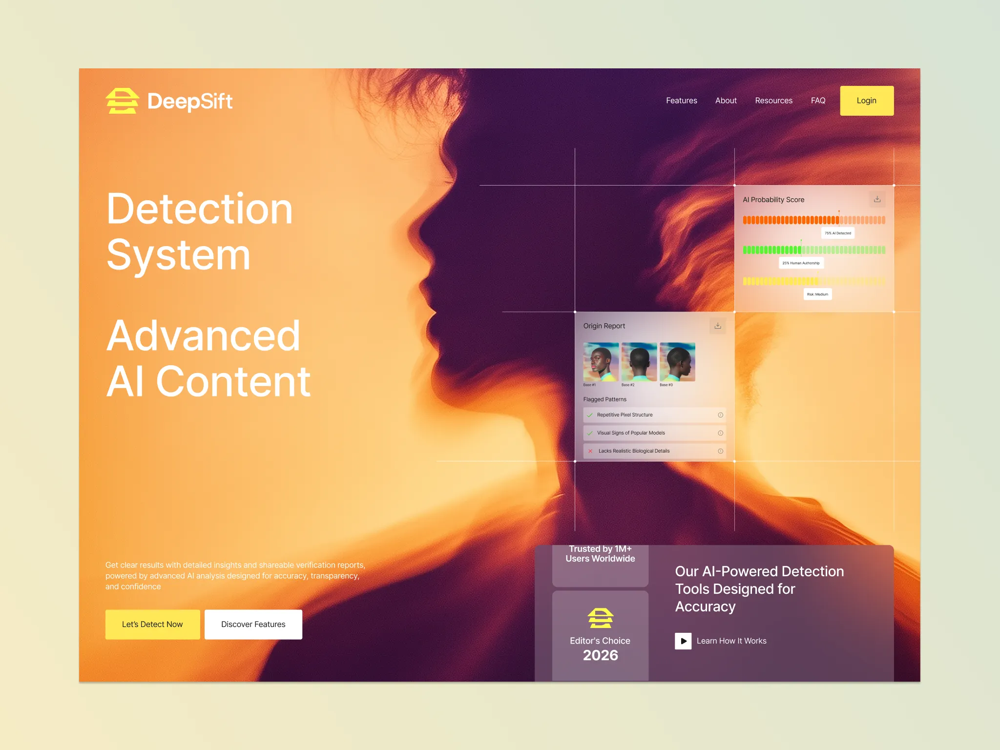

# Orange-to-plum blurred profile silhouette hero with white headline, yellow CTAs, glass report cards and crossing guide lines

**Discipline:** web · **Design type:** SaaS landing page
**Tags:** ai-detection, orange, plum, silhouette, glass-cards, guide-lines, yellow, hero

## What it is
A framed hero filled with a warm orange to deep plum gradient photo of a profile silhouette with flowing hair, a white 'Detection System Advanced AI Content' headline, yellow and white buttons, translucent report cards (AI Probability Score bars, Origin Report thumbnails, flagged patterns) tied together with thin white guide lines and dots, and a lower right glass panel with badges.

## What it means
Warm and analytic; the silhouette and glow keep an AI tool human.

## Techniques
- Use a gradient portrait as the backdrop.
- Overlay glass cards joined by thin guide lines.
- Show segmented bars for scores.
- Use yellow for the primary button.

## Best for
- AI detection and analysis tools
- Warm gradient heroes
- Glass report UI

## Vocabulary
- **Guide-line overlay** — Thin lines and dots linking overlay cards.
- **Segmented score bar** — A bar made of small blocks.
- **Silhouette backdrop** — A dark figure shape behind UI.
- **Warm gradient hero** — A hero in orange-to-plum tones.
