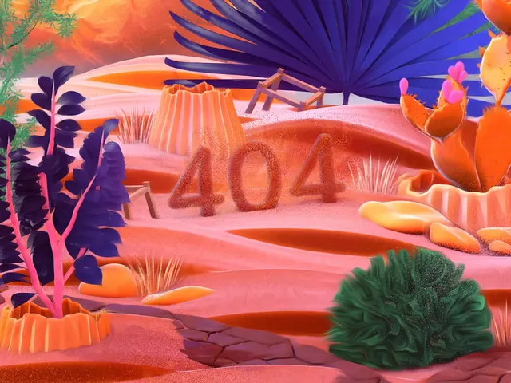

# Illustrated desert landscape in pink, orange and indigo with sandy '404' numerals

**Discipline:** web ·  · **Design style:** Playful & Illustrated
**Tags:** 404, error-page, illustration, desert, orange, indigo, pink, 3d-illustration

## What it is
A soft 3D-style illustration of sand dunes with orange rock pots, spiky indigo plants, a green bush, cacti with pink flowers and a fence, and the numerals '404' formed in sand across the middle.

## What it means
Warm and quirky; a tumbleweed-quiet desert makes an error page feel like a place.

## Techniques
- Form the error number from sand or terrain.
- Use complementary indigo and orange.
- Render in soft grainy 3D.
- Fill the whole frame with the scene.

## Best for
- Illustrated error pages
- Desert-themed brands
- Complementary palette scenes

## Vocabulary
- **Sand numerals** — Numbers made from sand.
- **Grainy 3D illustration** — A soft rendered scene with fine grain.
- **Complementary palette** — Indigo and orange used together.
- **Scene error page** — An error message integrated into an illustrated world.
