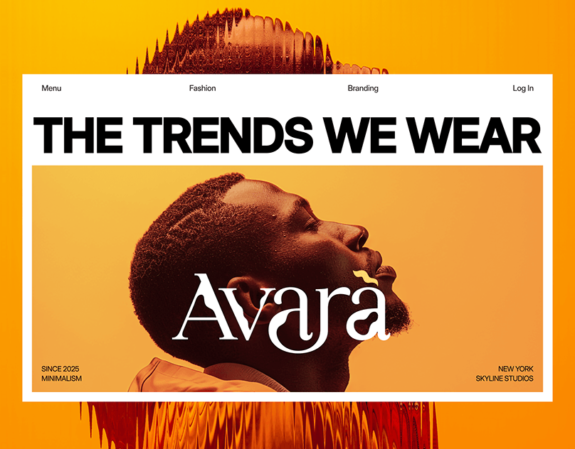

# Orange gradient hero with a white frame, giant black 'THE TRENDS WE WEAR', a profile portrait and melting reflection

**Discipline:** web · **Design type:** Landing page hero
**Tags:** fashion, orange, white-frame, giant-caps, serif-logo, profile-portrait, liquid-distortion, minimal

## What it is
An orange gradient poster with a liquid-distorted red reflection of a head above and below a white rectangle containing a thin nav, a giant heavy black 'THE TRENDS WE WEAR' and a photo of a man in profile looking up with a flourished white serif logo 'Avara' and tiny corner captions.

## What it means
Bold and warm; the melting reflection adds surreal energy to a clean layout.

## Techniques
- Frame a page as a white rectangle over a vivid field.
- Extend the subject as a distorted reflection.
- Set giant heavy caps as a headline.
- Overlay a serif logo on the photo.

## Best for
- Fashion and lifestyle heroes
- Poster-like site covers
- Orange gradient brands

## Vocabulary
- **Liquid distortion** — A warped melting effect on an image.
- **White frame** — A white panel holding UI over a colour field.
- **Profile portrait** — A side-view face photo.
- **Serif logo overlay** — A serif wordmark placed over a photo.
