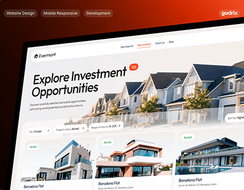

# Real-estate investment site on a tilted screen against a black-to-orange glow

**Discipline:** web ·  · **Design style:** Gradient & Aurora
**Tags:** real-estate, dark-orange, tilted, listing-cards, pills, project-cover, glow, perspective

## What it is
A close, tilted view of a website on a dark orange-black gradient. Top pills say Website Design, Mobile Responsive and Development; the page has 'Explore Investment Opportunities' with a counter badge, filter chips and cards for houses with status tags.

## What it means
Bold and warm; the glow makes a clean white site feel dramatic.

## Techniques
- Tilt the browser in perspective on a glowing gradient.
- Add small outlined pills above as service tags.
- Use a counter badge next to the headline.
- Show listing cards with small status chips.

## Best for
- Property and marketplace site covers
- Agency case-study thumbnails
- Warm dark presentation backdrops

## Vocabulary
- **Service tags** — Outlined pills listing what was delivered.
- **Glow gradient** — A dark background with a warm bloom.
- **Status chip** — A small label such as Rented on a card.
- **Perspective tilt** — An angled view of a screen.
