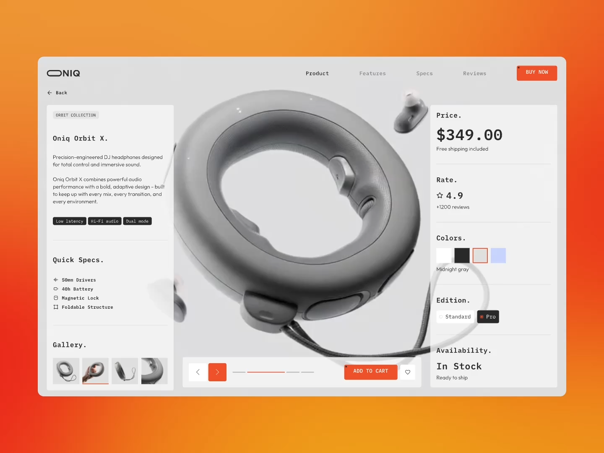

# Ring Headphones Product Page

**Discipline:** web · **Design type:** E-commerce
**Tags:** product-page, orange, monospace, 3d-render, grayscale, specs, modular

## What it is
A product page presented on an orange-red gradient: a light gray window with a huge grayscale render of ring-shaped headphones in the center, left panel with description, specs and gallery, right panel with price, rating, colors, edition and availability, and an orange CTA.

## What it means
A neutral gray interface lets the product and one hot orange accent dominate. Monospace headings with periods feel like a technical spec sheet.

## Techniques
- Oversized central product render breaking into the side panels
- Monospace headings ending in periods for a spec-sheet voice
- Single orange accent for CTAs, selected states and progress
- Modular side panels split by hairlines
- Gradient backdrop framing the window

## Best for
- Hardware and audio product launches
- Concept product pages
- Design-forward e-commerce

## Vocabulary
- **Spec sheet layout** — A structured list of attributes in a compact, labeled format.
- **Hero render** — A large 3D image of the product as the page's centerpiece.
- **Accent-only color** — Restricting saturated color to interactive and selected elements.
