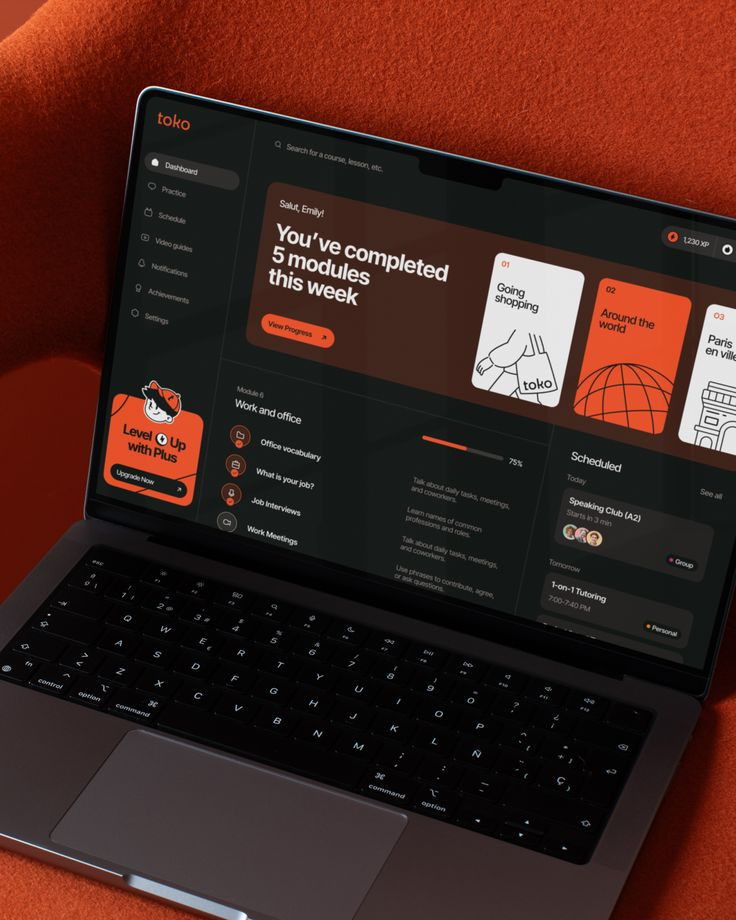

# Orange Learning Dashboard on Orange Felt

**Discipline:** web · **Design type:** Device mockup scene
**Tags:** laptop, orange, dark-ui, felt, education, dashboard, tilted

## What it is
A tilted laptop on orange felt showing a dark learning dashboard with progress hero, orange and white lesson cards, module list and a scheduled sessions panel.

## What it means
Matching the orange felt to the UI accent makes the scene feel intentional, and the dark UI makes cards pop.

## Techniques
- Textured felt in the brand colour
- Dark UI with orange highlight cards
- Line-illustrated lesson cards
- Angled laptop and crop
- Sidebar with a mascot upgrade card

## Best for
- Learning platforms
- Dark dashboard mockups
- Brand-colour scene matching

## Vocabulary
- **Brand-colour scene** — A setting whose colour matches the brand accent.
- **Lesson card** — A card representing a lesson with an illustration.
- **Upgrade card** — A sidebar card promoting a paid plan.
