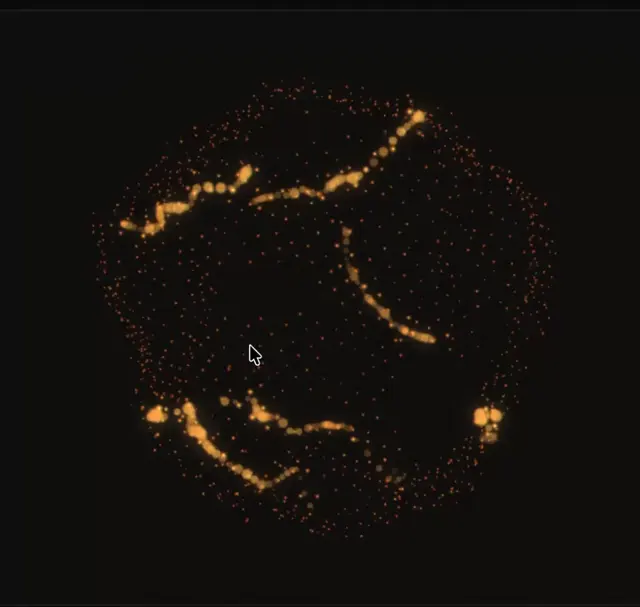

# Black field with a sphere of tiny orange dots and glowing beaded trails that follow the cursor

**Discipline:** web · **Design type:** Background pattern
**Tags:** particles, dark, orange, sphere, interactive, generative, glow, cursor

## What it is
A near-black canvas holding a loose spherical cloud of small orange dots and several glowing amber chains of larger beads curling through it, with a mouse cursor in the centre.

## What it means
Alive and organic; the dots and trails suggest energy responding to touch.

## Techniques
- Distribute dots on a sphere.
- Leave glowing trails where the pointer passes.
- Use one warm hue on black.
- Vary bead size along the trail.

## Best for
- Interactive hero backgrounds
- Generative art
- Dark tech and creative sites

## Vocabulary
- **Particle sphere** — Dots arranged on a spherical surface.
- **Pointer trail** — A glowing line left behind the cursor.
- **Bead chain** — Circles of varying size in a line.
- **Interactive canvas** — A background reacting to input.
