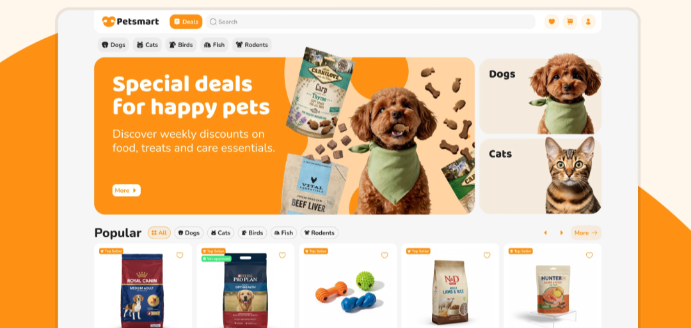

# Orange Pet Store Deals Homepage

**Discipline:** web ·  · **Design style:** Playful & Illustrated
**Tags:** pet-store, orange, cream, banner, categories, product-cards, friendly

## What it is
A wide rounded store page on an orange curve with a header of logo, orange Deals button, search and icons, pet category pills, a big orange hero 'Special deals for happy pets' with a dog and product bags, two stacked Dogs and Cats photo tiles and a Popular row of product cards with Top Seller tags.

## What it means
Warm orange and friendly pet photography feel cheerful and trustworthy, and cut-out products around the dog make the offer tangible.

## Techniques
- Orange hero banner with cut-out products and pet
- Stacked category photo tiles beside the hero
- Icon pills for pet categories
- Small orange tags on product cards
- White cards on a light grey ground

## Best for
- Pet and retail e-commerce
- Category-led storefronts
- Orange and white brand systems

## Vocabulary
- **Deals banner** — A hero promoting discounts with a photo and CTA.
- **Category pill** — A rounded label with an icon for browsing a category.
- **Top seller tag** — A small label marking a popular product.
