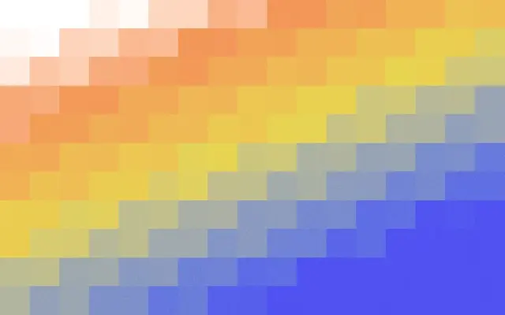

# Stepped square-tile gradient from white through orange and yellow to blue

**Discipline:** web · **Design type:** Background pattern
**Tags:** pattern, pixel-grid, gradient, orange, yellow, blue, tiles, background

## What it is
A rectangle of large stepped squares fading from white at the top left through peach, orange, yellow and grey-green to vivid blue at the bottom right.

## What it means
Warm-to-cool and digital; the blocky steps feel like a low-res sunset.

## Techniques
- Build a gradient from offset rows of tiles.
- Cross warm and cool hues diagonally.
- Use as a hero, cover or divider background.
- Keep tiles uniform in size.

## Best for
- Backgrounds for tech covers
- Pixel and retro-digital brands
- Section dividers

## Vocabulary
- **Stepped gradient** — A colour blend made of blocks.
- **Diagonal blend** — A gradient running corner to corner.
- **Low-res look** — Deliberately chunky pixels.
- **Warm-cool sweep** — A transition from warm to cool hues.
