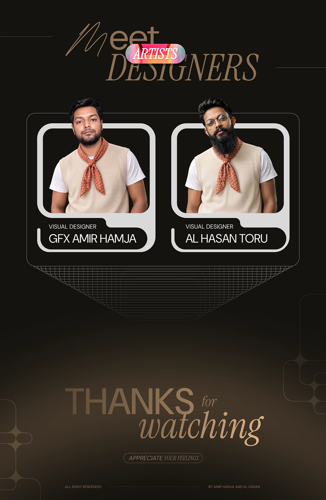

# Orlina case study closing: 'Meet Designers' portrait cards and a gold 'Thanks for watching'

**Discipline:** web · **Design type:** Case study closing slide · **Design style:** Editorial
**Tags:** credits, closing-slide, portrait, gold, dark, case-study

## What it is
A dark brown closing slide with a script-and-serif 'Meet Designers' heading, a small 'Artists' pill, two rounded photo cards of the designers in matching orange scarves with their names and role, and a large gold 'Thanks for watching' with 'Appreciate your feelings' below, over a faint radial grid.

## What it means
Personal and gracious; naming and picturing the team closes the story on a human note.

## Techniques
- Show both designers in matching styling for cohesion.
- Fade a radial grid behind the sign-off.
- Pair a script word with serif italics in the thank-you.

## Best for
- Portfolio closing slides
- Team credits
- Case study endings

## Vocabulary
- **Radial grid** — Concentric lines fading from a centre point.
- **Sign-off** — The closing message of a presentation.
