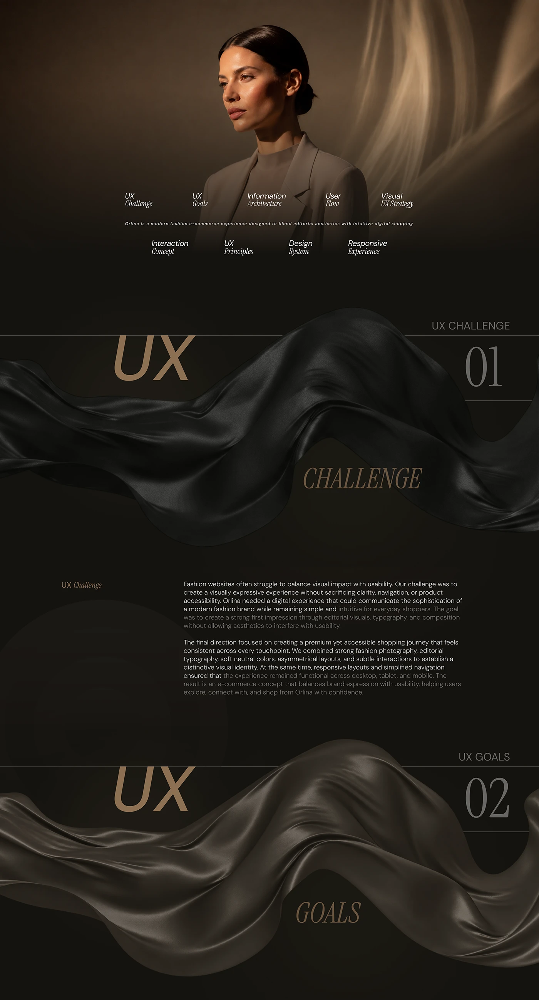

# Orlina case study intro: moody portrait, chapter index and 'UX Challenge' over flowing black silk

**Discipline:** web · **Design type:** Case study slide · **Design style:** Photographic & Cinematic
**Tags:** case-study, silk, dark, serif, chapters, fashion

## What it is
A tall dark page opening with a softly lit woman in a grey blazer, an italic serif chapter index (UX Challenge, Goals, Information Architecture, User Flow…), then big bronze 'UX' and italic 'Challenge' with a large '01' over a 3D ribbon of black satin, followed by a text block and '02 UX Goals'.

## What it means
Luxurious and cinematic; flowing fabric separates chapters like a fashion film.

## Techniques
- Use a flowing 3D fabric as each chapter divider.
- Number chapters with large thin numerals.
- Mix a bold sans with an italic serif in headings.

## Best for
- Fashion case studies
- Luxury presentations
- Long-scroll storytelling

## Vocabulary
- **Chapter divider** — A visual break introducing a new section.
- **Italic serif** — A slanted, elegant serif typeface.
