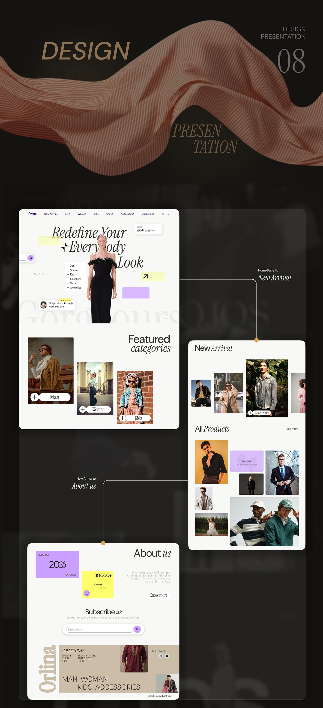

# Orlina 'Design Presentation 08' closing spread: home, new arrival and about pages linked by dotted lines

**Discipline:** web · **Design type:** Case study slide · **Design style:** Editorial
**Tags:** case-study, fashion, dark, connectors, closing-slide, editorial

## What it is
A dark page with a flowing copper silk ribbon and 'Design Presentation 08', below three linked screenshots: the editorial homepage, a New Arrival grid, and an About page with pink and yellow stat cards ('20% Discount', '30,000+ Orders'), joined by thin dotted lines and labels.

## What it means
Conclusive and tidy; ending on linked real screens proves the whole flow was designed, not just the hero.

## Techniques
- Close a case study by re-showing key linked screens.
- Label connectors with the page relationship.
- Keep the silk-ribbon divider motif consistent to the end.

## Best for
- Case study closings
- Fashion e-commerce
- Portfolio final slides

## Vocabulary
- **Stat card** — A small block highlighting one number.
- **Divider motif** — A repeated visual device marking sections.
