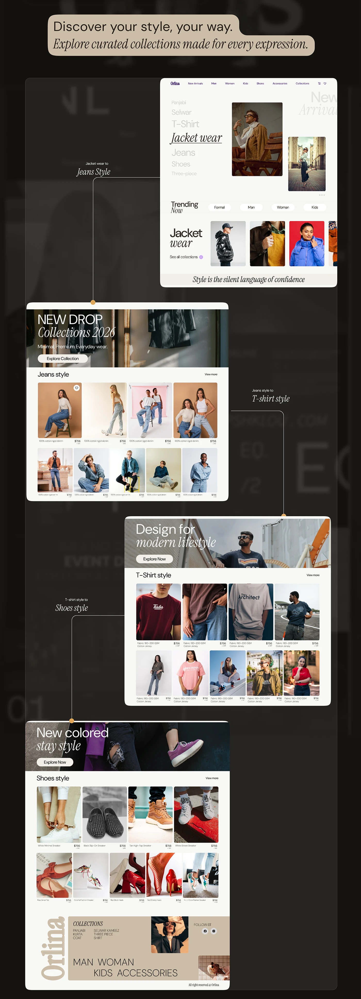

# Orlina 'Discover your style, your way' hero linking to Jeans, T-shirt and Shoes style pages

**Discipline:** web · **Design type:** E-commerce · **Design style:** Editorial
**Tags:** fashion, hero, editorial, product-cards, connectors, ecommerce

## What it is
A dark page with a beige quote pill 'Discover your style, your way. Explore curated collections made for every expression.' above a homepage screenshot, connected by dotted lines to three sub-pages: 'New Drop Collections 2026' (jeans), 'Design for modern lifestyle' (T-shirts) and 'New colored, stay comfy' (shoes).

## What it means
Guided and editorial; the quote sets intent, then real category pages prove it was delivered.

## Techniques
- Pair a homepage with its category sub-pages via connectors.
- Give each category page its own headline voice.
- Label each connector with the linked style.

## Best for
- Category page documentation
- Fashion site flows
- Case study UX slides

## Vocabulary
- **Sub-page** — A page reached from a main landing page.
- **Style category** — A product grouping like jeans or T-shirts.
