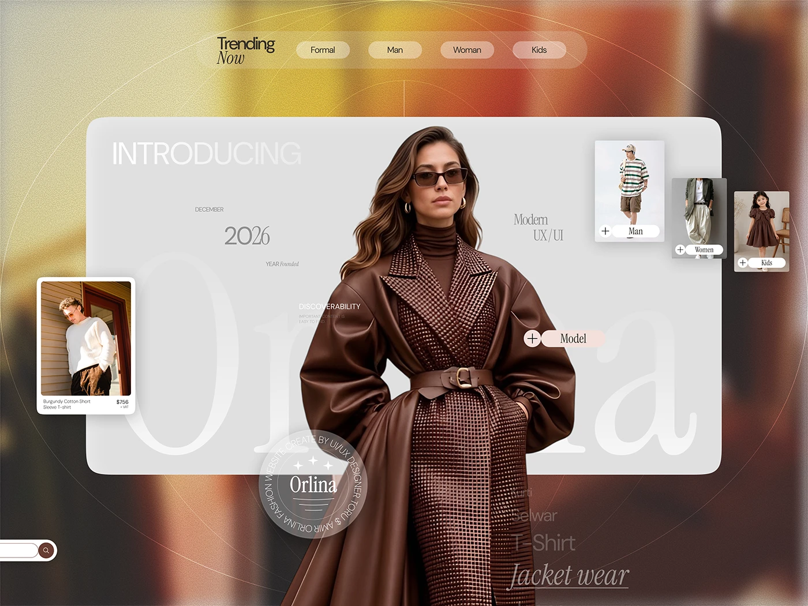

# Orlina fashion 'Introducing' hero: a model in a leather coat over a giant serif wordmark with floating product cards

**Discipline:** web · **Design type:** E-commerce · **Design style:** Editorial
**Tags:** fashion, ecommerce, editorial, serif, hero, case-study

## What it is
A blurred warm background with a grey rounded panel reading 'Introducing' and a giant faint 'Orlina' serif, a cut-out model in a brown leather coat and sunglasses standing in front, floating product and category cards (Man, Women, Kids), 'Trending Now' filter pills and a circular text badge.

## What it means
Luxurious and editorial; the model breaks out of the panel like a magazine cover.

## Techniques
- Let a cut-out model break out of the content panel.
- Set a giant faint serif wordmark behind.
- Float small product cards at different depths.

## Best for
- Fashion e-commerce
- Editorial storefronts
- Case study covers

## Vocabulary
- **Break-out** — An element extending beyond its container.
- **Editorial commerce** — Shopping design that borrows magazine style.
