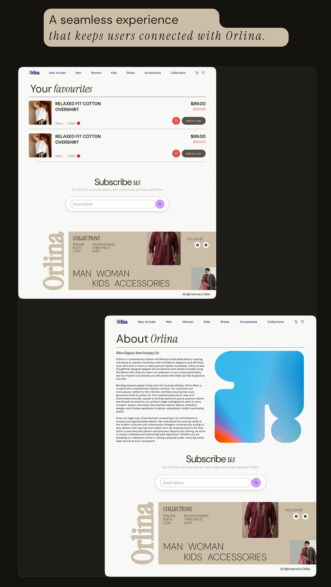

# Orlina favourites and about pages with a serif speech-bubble quote and rainbow gradient logo mark

**Discipline:** web · **Design type:** Page section · **Design style:** Editorial
**Tags:** ecommerce, favourites, about, speech-bubble, dark, fashion

## What it is
A dark page with a beige speech-bubble quote 'A seamless experience that keeps users connected with Orlina.' above a 'Your favourites' cart-style list and an About page with a long brand story beside a rainbow gradient abstract logo mark, both ending in the same footer.

## What it means
Personable and consistent; the speech bubble makes UX goals sound like a promise to the user.

## Techniques
- Frame a section goal as a speech-bubble quote.
- Pair a wishlist screen with the brand story page.
- Reuse the same footer across all screens for continuity.

## Best for
- Wishlist and account pages
- Brand story sections
- E-commerce case studies

## Vocabulary
- **Speech bubble** — A callout shape used for a quoted line.
- **Footer consistency** — Repeating the same footer for a unified feel.
