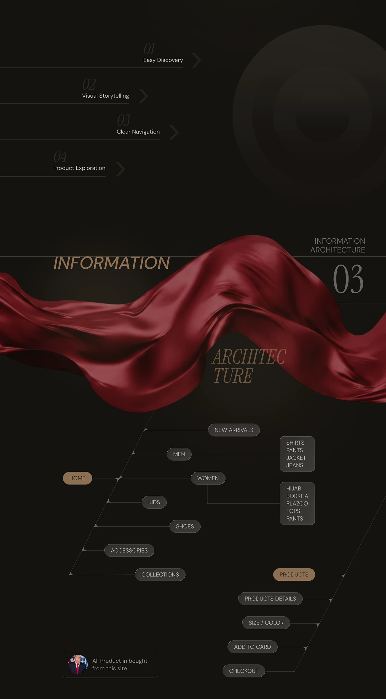

# Orlina information architecture: red silk divider and a branching sitemap of pill nodes

**Discipline:** web · **Design type:** UX documentation · **Design style:** Photographic & Cinematic
**Tags:** information-architecture, sitemap, dark, silk, ux, case-study

## What it is
A dark page with numbered goals (Easy Discovery, Visual Storytelling, Clear Navigation, Product Exploration), a red satin ribbon behind 'Information Architecture 03', and a sitemap drawn as thin diagonal lines branching from a bronze 'Home' pill to pills like New Arrivals, Men, Women, Kids and a checkout path.

## What it means
Clear yet stylish; a technical sitemap gets the same luxe treatment as the visuals.

## Techniques
- Draw a sitemap with diagonal branches and pill nodes.
- Highlight start and key nodes in the accent colour.
- Precede it with numbered goals.

## Best for
- UX case studies
- Sitemaps
- E-commerce navigation planning

## Vocabulary
- **Information architecture** — How content and pages are organised.
- **Sitemap** — A diagram of a site's pages and hierarchy.
