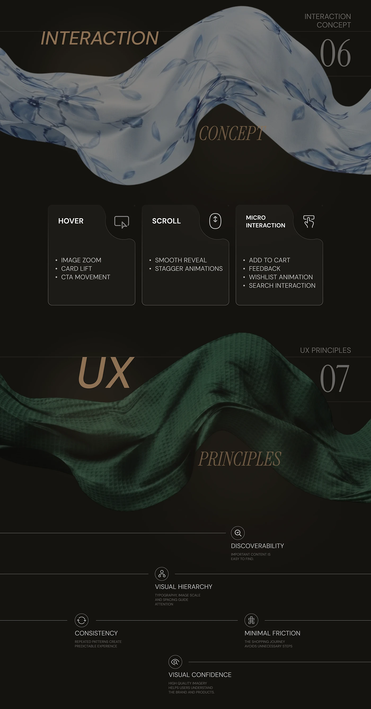

# Orlina interaction concept cards (hover, scroll, micro-interaction) and UX principles on a timeline

**Discipline:** web · **Design type:** UX documentation · **Design style:** Photographic & Cinematic
**Tags:** interaction, micro-interactions, ux-principles, dark, silk, case-study

## What it is
A dark page with a blue floral silk ribbon for 'Interaction Concept 06' and three notched cards (Hover: image zoom, card lift; Scroll: smooth reveal; Micro Interaction: add to cart, wishlist), then a green silk ribbon for 'UX Principles 07' with icons for Discoverability, Visual Hierarchy, Consistency, Minimal Friction and Visual Confidence on horizontal lines.

## What it means
Thoughtful and premium; even abstract principles get tactile fabric and tidy icon cards.

## Techniques
- List interaction behaviours in three icon cards.
- Change the ribbon fabric colour per chapter.
- Lay principles along staggered horizontal rules.

## Best for
- Interaction specs
- UX principle pages
- Case study documentation

## Vocabulary
- **Micro-interaction** — A small animated response to one action.
- **Hover state** — How an element looks when the cursor is over it.
