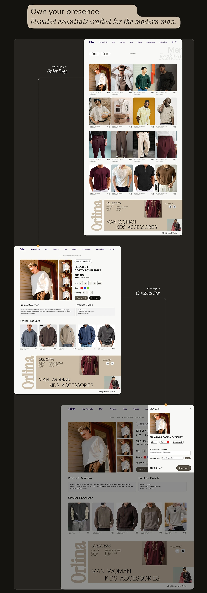

# Orlina men's catalogue, product page and cart drawer flow with a quote banner

**Discipline:** web · **Design type:** Checkout and forms · **Design style:** Editorial
**Tags:** ecommerce, checkout, catalogue, cart, dark, fashion

## What it is
A dark page with a quote banner 'Own your presence. Elevated essentials crafted for the modern man.' above a men's catalogue grid, a product detail page (Relaxed Fit Cotton Overshirt, size and colour options, similar products) and a small cart drawer overlay showing item, quantity and checkout total, linked by lines.

## What it means
Complete and premium; the quote frames a purely functional shopping flow in brand voice.

## Techniques
- Open a functional flow with a branded quote.
- Overlay a cart drawer as a small floating panel.
- Show size and colour pickers explicitly.

## Best for
- Menswear e-commerce
- Checkout flow documentation
- Case study UX slides

## Vocabulary
- **Cart drawer** — A slide-out panel showing the current cart.
- **Quote banner** — A short branded statement used as a section intro.
