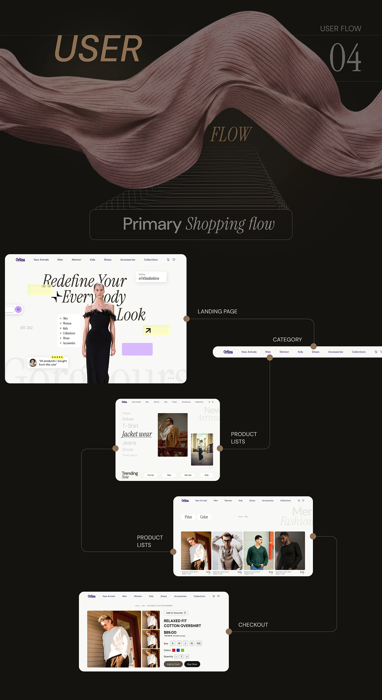

# Orlina user flow: primary shopping flow pages linked by bronze connector lines

**Discipline:** web · **Design type:** UX documentation · **Design style:** Photographic & Cinematic
**Tags:** user-flow, ecommerce, dark, connectors, fashion, case-study

## What it is
A dark page with a mauve silk ribbon and 'User Flow 04', a 'Primary Shopping flow' label, and screenshots of the landing, category, product lists and checkout pages zig-zagging down, joined by thin lines with bronze dots and labels.

## What it means
Guided and tangible; real screens replace boxes so the flow feels like the actual journey.

## Techniques
- Use real screenshots as flowchart nodes.
- Zig-zag screens down the page.
- Mark connections with small accent dots.

## Best for
- User flow documentation
- E-commerce journeys
- Case study presentations

## Vocabulary
- **User flow** — The path a user takes to finish a task.
- **Connector** — A line linking steps in a diagram.
