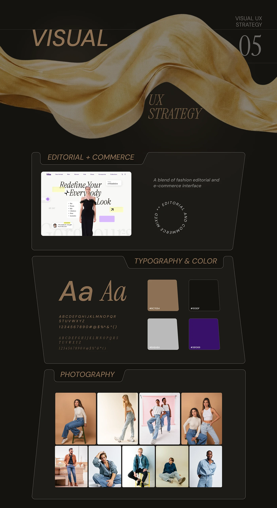

# Orlina visual UX strategy as folder-tab panels: editorial+commerce, type and colour, photography

**Discipline:** web · **Design type:** Typography and colour guide · **Design style:** Editorial
**Tags:** style-guide, typography, colour, folder-tabs, fashion, dark

## What it is
A dark page with a gold silk ribbon and 'Visual UX Strategy 05', then three folder-tab panels: 'Editorial + Commerce' with a homepage screenshot and circular text badge, 'Typography & Color' with sans and italic serif 'Aa' specimens and brown, black, grey and purple swatches, and 'Photography' with a grid of denim shoots.

## What it means
Organised and tactile; folder tabs make a style guide feel like a designer's archive.

## Techniques
- Frame each guide section as a folder with a tab.
- Pair two typefaces as big 'Aa' specimens.
- Show photography direction as a grid of real shots.

## Best for
- Style guides
- Case study visual strategy
- Fashion brand guidelines

## Vocabulary
- **Type specimen** — A sample showing a typeface's characters.
- **Swatch** — A sample block of a colour.
