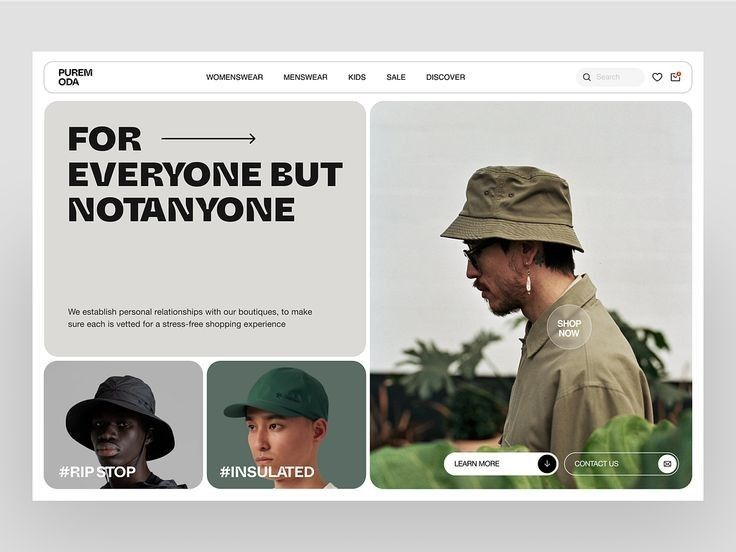

# Outdoor clothing homepage as a bento of grey headline card and photo tiles

**Discipline:** web ·  · **Design style:** Geometric & Bauhaus
**Tags:** fashion, bento, hero, olive, heavy-type, photo-tiles, pill-nav, hats

## What it is
A white rounded frame with a pill nav and search. Inside, a warm grey card with a heavy caps headline 'FOR EVERYONE BUT NOTANYONE' and an arrow, two small photo tiles of hats with hashtags, and a tall photo of a man in an olive bucket hat with a translucent SHOP NOW circle and two pill buttons.

## What it means
Confident and editorial; a bento of unequal tiles gives a fashion feel.

## Techniques
- Split the hero into one text card and several photo tiles.
- Set a heavy grotesque headline with an inline arrow.
- Overlay a translucent circular button on the photo.
- Tint tiles to match the clothing (olive, green, grey).

## Best for
- Fashion and outdoor brands
- Editorial e-commerce
- Photo-led homepages

## Vocabulary
- **Bento hero** — A hero made of tiles of different sizes.
- **Hashtag tag** — A label with a hashtag over a photo.
- **Shop-now disc** — A translucent circle acting as a button.
- **Pill nav** — A navigation bar in a rounded capsule.
