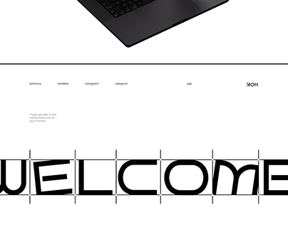

# Portfolio footer with a giant boxed WELCOME in tech-rounded type

**Discipline:** web ·  · **Design style:** Minimalist
**Tags:** portfolio, typography, monochrome, footer, grid-lines, laptop-mockup, link-list

## What it is
A cropped laptop above a white footer: a row of small text links, a short greeting, and an enormous black 'WELCOME' in wide rounded letters, each character in its own cell separated by thin vertical lines and cropped at the edge.

## What it means
Bold, calm and confident; the oversized word makes the footer the finale.

## Techniques
- Set a single giant word across the whole width of the footer.
- Separate letters with hairline grid cells for a drafting-sheet look.
- Crop the letterforms at the bottom and sides for scale.
- Keep everything else tiny so the word dominates.

## Best for
- Portfolio and studio websites
- Footers and closing sections
- Type-driven, minimal brands

## Vocabulary
- **Giant footer word** — A huge word closing the page.
- **Letter cells** — Hairline boxes around each letter.
- **Drafting look** — A layout style resembling technical drawings.
- **Cropped type** — Letters cut by the frame.
