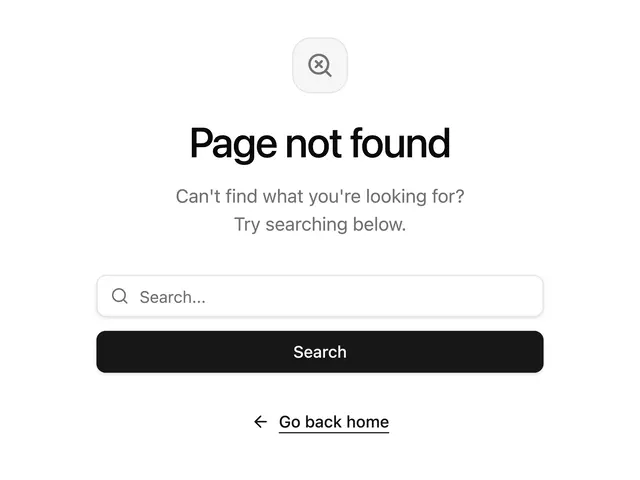

# White 'Page not found' with a magnifier-x icon tile, a wide search field, a black Search button and an arrow 'Go back home' link

**Discipline:** web · **Design type:** Page section
**Tags:** 404, error-page, white, black, search, icon-tile, minimal, centered

## What it is
A centred white page with a soft rounded icon tile holding a magnifier with an x, a big bold black 'Page not found', a grey two-line hint 'Try searching below.', a bordered search input, a full-width black Search button and an underlined link with a left arrow 'Go back home'.

## What it means
Helpful and calm; giving a search field turns a dead end into a next step.

## Techniques
- Offer search on an error page.
- Use a soft icon tile as the only graphic.
- Use a black primary and a text link secondary.
- Keep the copy short.

## Best for
- 404 and empty-search states
- Minimal error pages
- Search-led recovery

## Vocabulary
- **Search recovery** — Offering search when a page is missing.
- **Icon tile** — A rounded square with a symbol.
- **Return link** — A link back to the home page with an arrow.
- **Centred stack** — Elements stacked on one vertical axis.
