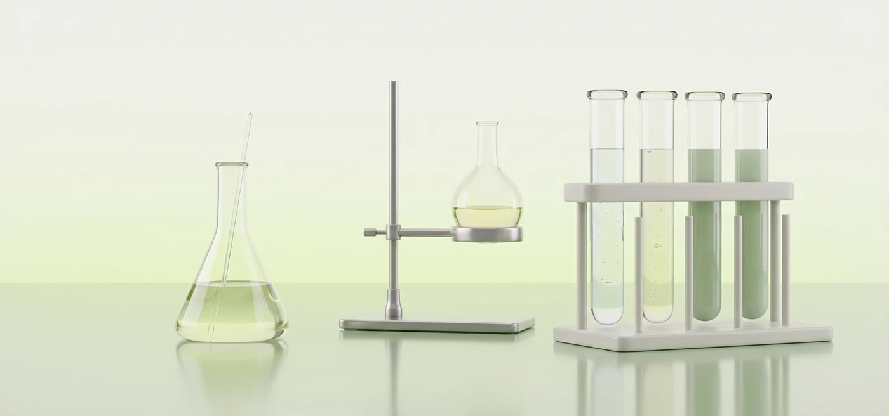

# Soft 3D flask, stand and test-tube rack with pale green liquids on a mint table

**Discipline:** web · **Design type:** 3D illustration
**Tags:** 3d-render, lab, glassware, mint, green, reflection, hero-asset, science

## What it is
A wide render of an Erlenmeyer flask, a round flask on a metal stand and a rack of four test tubes filled with light green liquids, standing on a reflective mint surface against a white-to-lime gradient.

## What it means
Calm and clean; pale tints make lab equipment feel nourishing and natural.

## Techniques
- Render glassware with subtle reflections on a glossy floor.
- Keep liquids in soft green tints.
- Use a vertical gradient wall behind.
- Space objects evenly across a wide banner.

## Best for
- Biotech and skincare heroes
- Section banners
- Science visuals with a soft tone

## Vocabulary
- **Glossy floor** — A reflective surface in a render.
- **Tinted liquid** — Coloured fluid in glass.
- **Gradient wall** — A background fading in colour.
- **Banner render** — A wide 3D scene used as a header.
