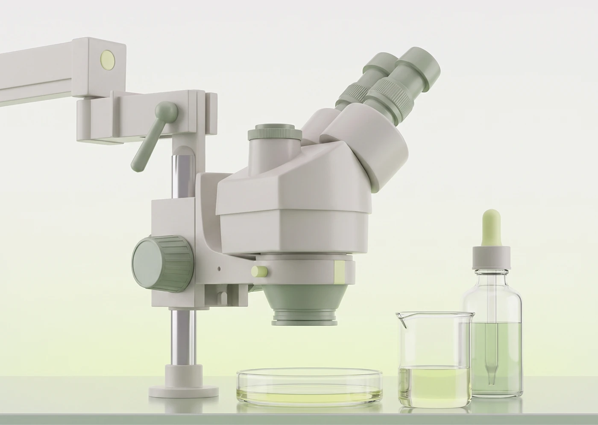

# Soft 3D lab microscope, petri dish and dropper bottle in sage and cream

**Discipline:** web ·  · **Design style:** 3D & Surreal
**Tags:** 3d-render, microscope, lab, sage-green, cream, clay, botanical, hero-asset

## What it is
A matte clay-style render of a microscope on an arm stand beside a petri dish, beaker and dropper bottle with pale green liquid, on a soft gradient from white to lime.

## What it means
Clean, gentle science; pastel materials make a lab feel friendly rather than clinical.

## Techniques
- Render technical equipment in soft matte pastels.
- Limit colours to cream, sage and one lime accent.
- Use glass with tinted liquid for delicate contrast.
- Light softly with a gradient backdrop.

## Best for
- Biotech, skincare and wellness imagery
- Website hero and section assets
- Science topics needing warmth

## Vocabulary
- **Clay render** — A 3D style with matte, soft-looking materials.
- **Tinted glass** — Transparent material with a coloured liquid inside.
- **Pastel palette** — Low-saturation soft colours.
- **Hero asset** — A key image used at the top of a page.
