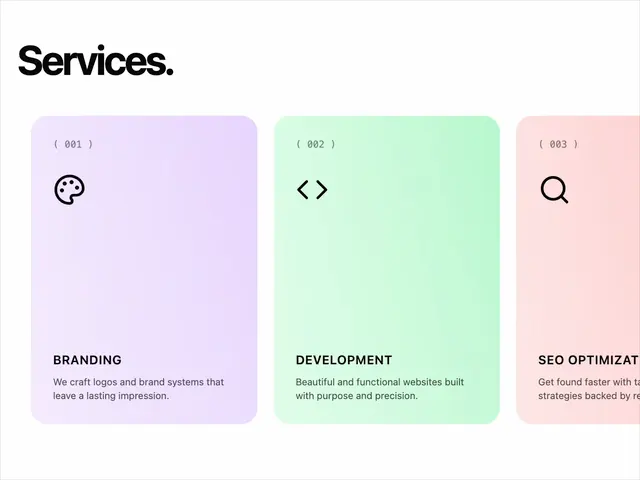

# 'Services.' heading with tall rounded cards in lilac, mint and blush gradients, each with a (00N) label, an icon, caps title and short text

**Discipline:** web · **Design type:** Landing page sections
**Tags:** services, pastel-gradient, lilac, mint, blush, cards, monospace, icons

## What it is
A white page with a giant bold 'Services.' and a horizontal row of tall rounded cards with soft gradients (lilac, mint, blush), each with a monospace number in brackets '( 001 )', a thin black icon (palette, code, magnifier), an uppercase title (Branding, Development, SEO Optimization) and a short grey description at the bottom.

## What it means
Fresh and orderly; soft colour gradients differentiate services without heavy graphics.

## Techniques
- Give each card its own pastel gradient.
- Number with monospace bracketed labels.
- Use one thin icon per card.
- Bleed the last card off the edge.

## Best for
- Agency service sections
- Pastel card rows
- Minimal portfolio sites

## Vocabulary
- **Gradient card** — A card filled with a soft colour gradient.
- **Bracket number** — A monospace index like ( 001 ).
- **Cropped carousel** — A row whose last item is cut by the edge.
- **Service card** — A card describing one offering.
