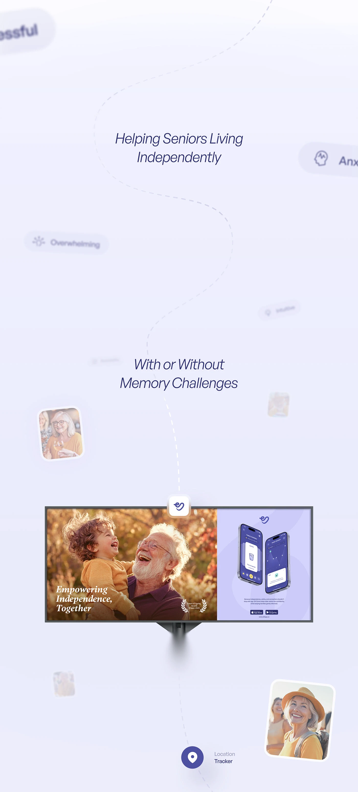

# Lilac scroll with italic sans lines, a dashed winding route, blurred symptom tags, small photo cards and a billboard-style screen

**Discipline:** web · **Design type:** Landing page sections
**Tags:** healthcare, lilac, dashed-route, blur, italic, photo-cards, billboard-screen, senior-care

## What it is
A very pale lilac tall page with a winding dashed line linking centred italic lines ('Helping Seniors Living Independently', 'With or Without Memory Challenges'), blurred floating tags (Overwhelming, Anxious), small tilted photo cards of seniors, a wide screen showing a grandfather laughing with a child and a purple phones panel, and a location-tracker pin at the end.

## What it means
Gentle and reassuring; the dashed route and blur guide the eye softly through a story.

## Techniques
- Link sections with a dashed winding line.
- Blur floating tags in the periphery.
- Use tilted small photos.
- Show a wide screen mid-page.

## Best for
- Care and wellbeing apps
- Story-led scrolling pages
- Soft lilac layouts

## Vocabulary
- **Dashed route** — A dotted line winding through a page.
- **Blurred tag** — A softly out-of-focus label as decoration.
- **Tilted photo card** — A small rotated photo with a white border.
- **Pin end-point** — A location pin closing a route.
