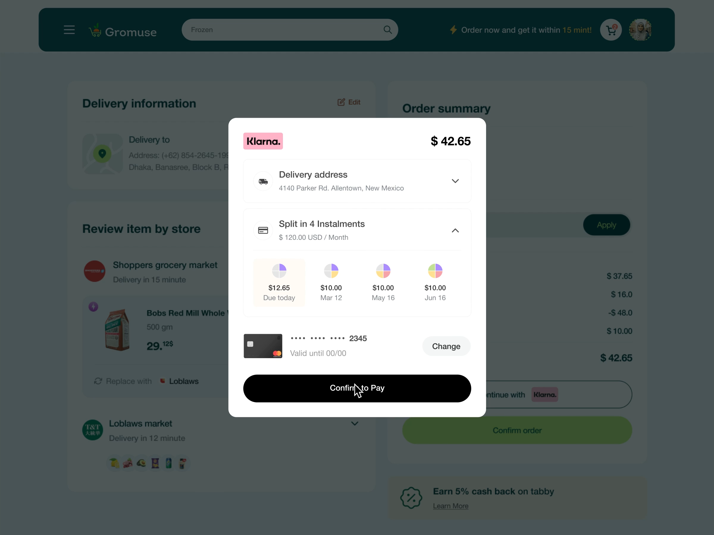

# Installment Payment Modal

**Discipline:** web ·  · **Design style:** Dark & Neon
**Tags:** modal, payment, overlay, installments, checkout, white-card, scrim

## What it is
A white centered modal from a payment provider over a dimmed checkout: pink logo tag and total, collapsible delivery address, a split-in-4 installment timeline with pie-icons, a card row with Change, and a black Confirm to Pay button.

## What it means
The dimmed background isolates the decision, and the black pill button makes the final commitment unmistakable.

## Techniques
- Dark scrim behind a bright modal for focus
- Pie-progress icons to show installments filling up
- Stacked collapsible rows to manage density
- Black pill for the final confirm to differ from the app's lime CTA
- Third-party brand color (pink tag) as a trust marker

## Best for
- Payment and confirmation overlays
- Buy-now-pay-later flows
- Any high-stakes single decision

## Vocabulary
- **Scrim** — A translucent dark layer that dims the page behind a modal.
- **Installment timeline** — A row showing each payment date and amount.
- **Progress pie** — A small circle filled by quarters to show progress.
