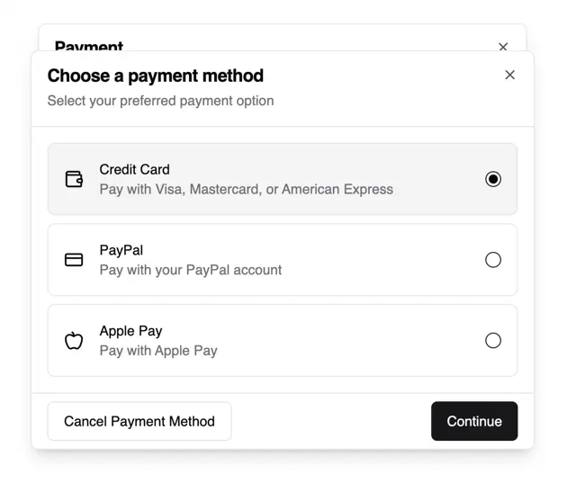

# Modal 'Choose a payment method' with three radio cards, a selected grey state, and a Cancel and black Continue footer

**Discipline:** web ·  · **Design style:** Minimalist
**Tags:** component, modal, radio-cards, payment, white, black-button, stacked-dialog, ui-kit

## What it is
A white modal over a second dialog peeking behind, with a bold title, a grey subtitle, a hairline, three rounded radio cards (Credit Card selected in grey, PayPal, Apple Pay) each with an icon, description and radio circle, and a footer with an outlined Cancel and a black Continue.

## What it means
Clear and calm; card-style radio options make choices easy to scan.

## Techniques
- Use full-width radio cards.
- Tint the selected card grey.
- Stack a second dialog behind.
- Pair outlined Cancel with a black primary.

## Best for
- Payment and checkout modals
- Radio card components
- Minimal dialogs

## Vocabulary
- **Radio card** — A selectable card with a radio circle.
- **Stacked dialog** — A dialog partly hidden behind another.
- **Modal footer** — The bottom row of actions in a dialog.
- **Selected state** — The chosen option tinted or filled.
