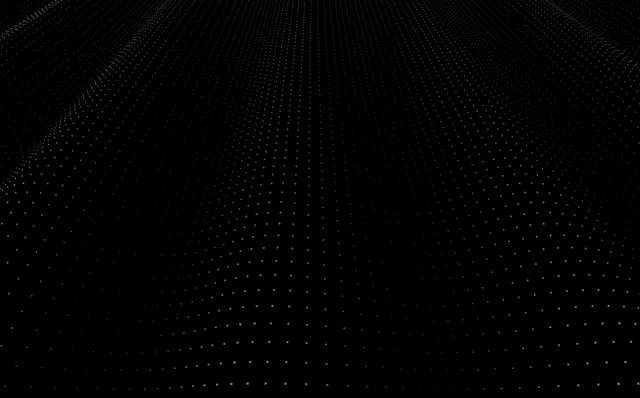

# Black plane of tiny white dots in perspective, waving gently toward the horizon

**Discipline:** web · **Design type:** Background pattern
**Tags:** background, dots, dark, perspective, wave, generative, minimal, particles

## What it is
A pure black canvas covered by a receding grid of tiny grey-white dots that ripples like a fabric sheet, dense near the horizon and sparse at the bottom.

## What it means
Quiet and spatial; the dot plane gives depth without any imagery.

## Techniques
- Lay a dot grid in perspective.
- Ripple it with a soft wave.
- Fade dots with distance.
- Use only white on black.

## Best for
- Dark hero backgrounds
- Particle-field backdrops
- Minimal tech sites

## Vocabulary
- **Dot plane** — A grid of dots laid in perspective.
- **Particle field** — Many small points forming a texture.
- **Wave displacement** — A ripple moving through a grid.
- **Depth fade** — Elements dimming with distance.
