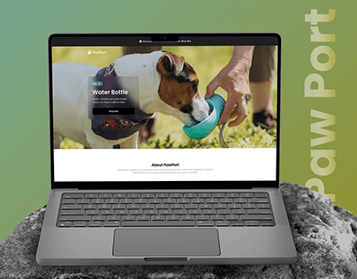

# Pet product site on a laptop resting on a rock with vertical ghost title

**Discipline:** web · **Design type:** Project cover
**Tags:** laptop-mockup, pet, green-gradient, rock, product-hero, vertical-title

## What it is
A green gradient background with a laptop showing a website hero of a dog drinking from a water bottle. The laptop rests on a grey rock, and a big translucent 'Paw Port' is written vertically at the right.

## What it means
Outdoorsy, friendly and simple; the rock ties the mockup to the outdoors theme.

## Techniques
- Prop the device on a natural material that matches the brand story.
- Use a vertical ghost title to fill space without competing.
- Match background gradient to the site's hero photo.
- Keep the mockup front and centre.

## Best for
- Outdoor, pet and lifestyle e-commerce
- Student and portfolio website presentations
- Simple project covers

## Vocabulary
- **Ghost title** — A large low-opacity project name.
- **Vertical text** — Text rotated 90 degrees.
- **Prop staging** — Placing an object on a themed prop.
- **Hero photo** — A large opening image on a website.
