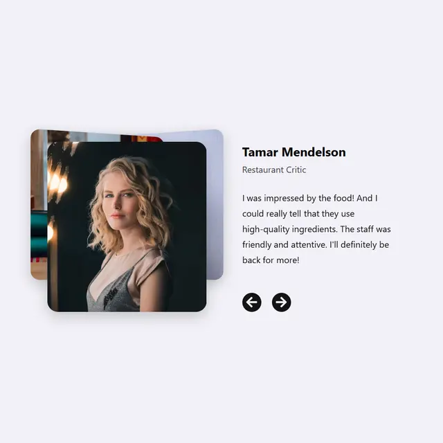

# Stacked rounded photo cards with the front portrait sharp, beside a name, role, quote and two black circular arrows

**Discipline:** web · **Design type:** UI components
**Tags:** component, testimonial, card-stack, portrait, black-buttons, pale-lilac, shadow, carousel

## What it is
A pale lilac-grey field with a stack of rounded photo cards behind a front portrait of a woman in dark light, and at the right a bold name 'Tamar Mendelson', a grey role, a paragraph review and two black circular arrow buttons.

## What it means
Personal and polished; a stack of photos suggests more voices behind the first.

## Techniques
- Offset background photo cards behind the front one.
- Pair a large portrait with a bold name.
- Use black circular arrows.
- Keep a soft shadow.

## Best for
- Testimonial sliders
- Photo stack components
- Restaurant and service sites

## Vocabulary
- **Photo stack** — Overlapping cards showing depth.
- **Round arrow buttons** — Black circles with left and right arrows.
- **Name and role** — A bold name with a lighter title.
- **Front card** — The active image at the top of a stack.
