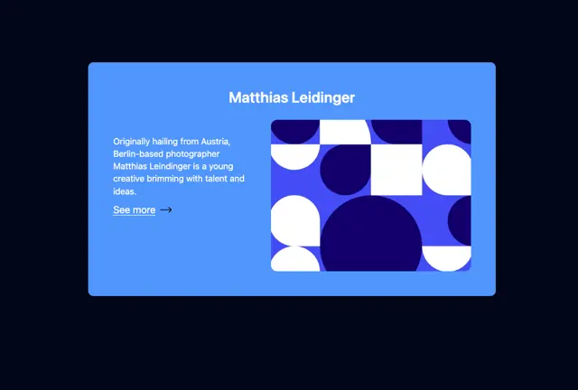

# Cornflower card on navy with a centred name, short bio, See more link and rounded artwork of white and indigo circle and square tiles

**Discipline:** web · **Design type:** UI components
**Tags:** component, profile-card, blue, navy, geometric, tiles, circles, minimal

## What it is
A deep navy page with a cornflower blue rounded card holding a white centred name 'Matthias Leidinger', a short paragraph, an underlined 'See more' with an arrow at the left and, at the right, a rounded image of Bauhaus-like tiles of white and dark indigo circles, quarter circles and squares on a bright blue ground.

## What it means
Modern and playful; geometric tile art gives a simple profile card an art-gallery feel.

## Techniques
- Set artwork from simple circles and squares.
- Use a single blue family on navy.
- Pair text left with a rounded image right.
- Keep an underlined link.

## Best for
- Profile and artist cards
- Geometric pattern art
- Blue and navy components

## Vocabulary
- **Bauhaus tile art** — Compositions from circles, arcs and squares.
- **Profile card** — A card summarising a person.
- **See more link** — An underlined link with an arrow.
- **Tonal blues** — Several shades of blue used together.
