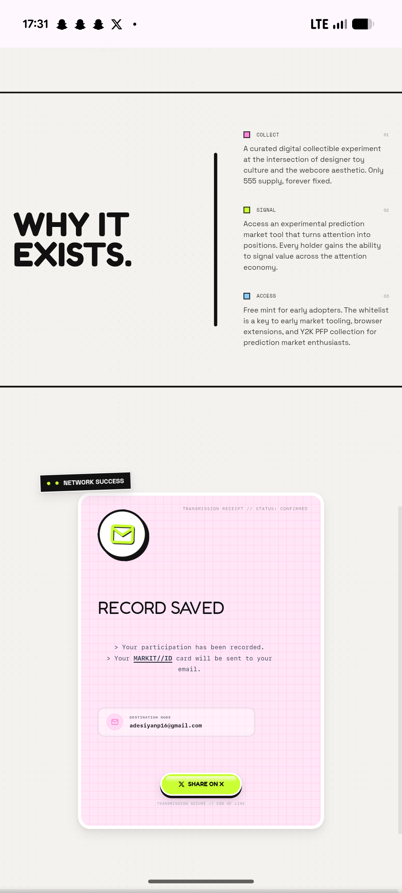

# Pink Grid Transmission Receipt Success Card

**Discipline:** web ·  · **Design style:** Neo-Brutalist
**Tags:** success-state, receipt, pink, grid-paper, monospace, lime, sticker

## What it is
A tall pink graph-paper card with a black 'Network Success' label tag, a round white icon holding a lime envelope, a light 'RECORD SAVED' heading, terminal-style confirmation lines, a destination field and a lime SHARE ON X pill with a black underlay, beside a manifesto section.

## What it means
Framing a form submission as a system receipt makes a small moment memorable, and the grid paper feels like a printout.

## Techniques
- Pink graph-paper background
- Terminal-style prompt lines with > markers
- Round icon badge with a hard shadow
- Label tag tilted over the card corner
- Lime candy button for the next step

## Best for
- Form success and confirmation states
- Webcore and terminal aesthetics
- Playful receipt-style feedback

## Vocabulary
- **Success state** — The screen shown after an action completes.
- **Graph paper** — A grid pattern used as a background.
- **Receipt styling** — Text laid out like a printed transaction slip.
