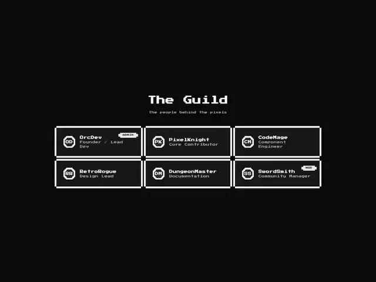

# Black page 'The Guild' with six member cards in pixel type and chunky white pixel borders, with ADMIN and MOD badges

**Discipline:** web ·  · **Design style:** Retro & Pixel
**Tags:** component, pixel-art, 8-bit, black, white, member-cards, retro, badges

## What it is
A black page with a pixel-font title 'The Guild' and caption, and a 3x2 grid of cards drawn with double white pixel borders, each with a round monogram badge (OD, PK, CM, RR, DM, SS), a bold pixel name, a role line and small ADMIN or MOD tags.

## What it means
Nostalgic and playful; pixel borders and type turn a team list into a game roster.

## Techniques
- Draw borders with stepped pixel corners.
- Set text in a pixel font.
- Use monogram badges as avatars.
- Add tiny role tags.

## Best for
- Gaming and retro team pages
- Pixel-style UI kits
- Community rosters

## Vocabulary
- **Pixel border** — A border built from square steps.
- **Pixel font** — A typeface designed on a pixel grid.
- **Monogram badge** — A round badge with initials.
- **Role tag** — A tiny label such as ADMIN.
