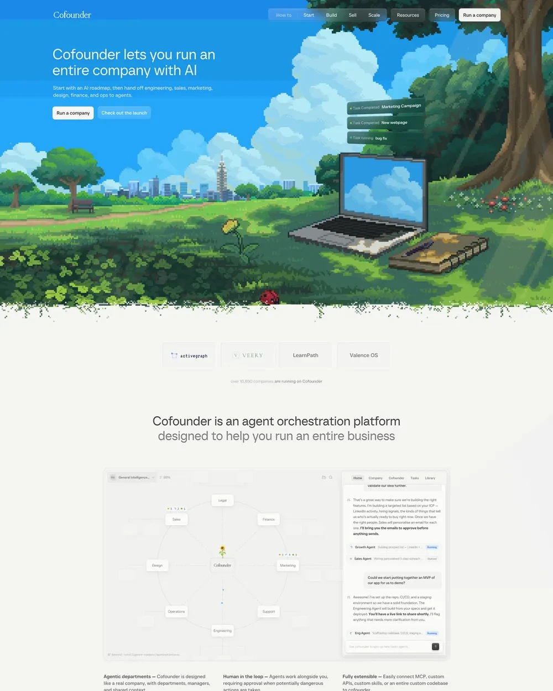

# Pixel-Art Landscape Hero Landing Page

**Discipline:** web ·  · **Design style:** Retro & Pixel
**Tags:** pixel-art, nostalgia, hero-illustration, blue-sky, ai, glass-nav, game-like

## What it is
A landing page whose entire hero is a lush pixel-art park scene with a laptop and notebook on the grass, floating task-status chips and glass nav pills, ending in a pixelated grass edge before a clean white section with logos and a diagram.

## What it means
Nostalgic game art makes an abstract idea like running a company with AI feel playful and approachable. The clean section beneath returns to sober credibility.

## Techniques
- Full-bleed pixel-art scene as the hero
- Frosted glass nav pills over the illustration
- Floating status chips in the scene that hint at the product
- Pixelated dissolve edge as the transition to the clean section
- Muted gray diagram below to contrast with the saturated hero

## Best for
- Indie and AI tools wanting personality
- Game-adjacent brands
- Launch pages that need memorability

## Vocabulary
- **Pixel art** — Illustration built from visible square pixels.
- **Glass nav** — Semi-transparent frosted navigation elements.
- **Edge dissolve** — A scattered, broken border between two sections.
