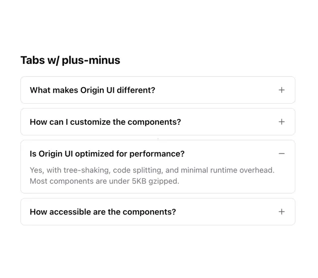

# Bordered FAQ rows with plus and minus icons; the open row shows a short grey answer

**Discipline:** web · **Design type:** UI components
**Tags:** component, accordion, plus-minus, faq, white, bordered, minimal, ui-kit

## What it is
A white component 'Tabs w/ plus-minus' with four separate rounded bordered rows of bold questions; three show a plus at the right and the third is open with a minus and a two-line grey answer.

## What it means
Clean and legible; plus and minus icons make expandability instantly clear.

## Techniques
- Separate each item in its own bordered card.
- Use plus and minus instead of chevrons.
- Show answers in grey under the question.
- Keep bold questions.

## Best for
- FAQ components
- Accordion patterns
- Minimal documentation UI

## Vocabulary
- **Plus-minus toggle** — An icon that switches between plus and minus.
- **Bordered row** — A row inside its own thin border.
- **Answer text** — Grey supporting text shown when open.
- **Card accordion** — An accordion whose items are separate cards.
