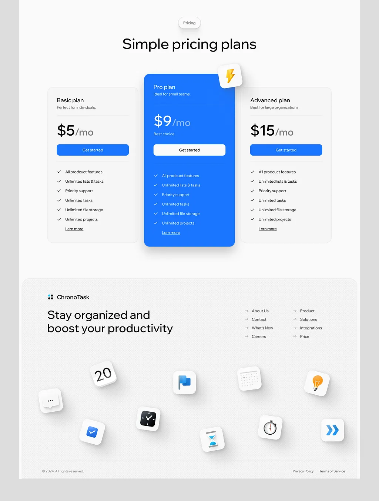

# Pricing with a raised blue Pro card and a footer strewn with floating 3D app-icon tiles

**Discipline:** web ·  · **Design style:** 3D & Surreal
**Tags:** pricing, footer, blue, white, 3d-icons, raised-card, saas, light

## What it is
A white page with a 'Pricing' pill, 'Simple pricing plans', three cards in which the middle Pro plan is saturated blue and lifted with a lightning tile and a white button while the others are pale with blue buttons, and a grey dotted footer 'Stay organized and boost your productivity' with link columns and scattered 3D icon tiles (calendar, clock, check, flag, bulb, hourglass, chevrons).

## What it means
Clear and cheerful; a raised blue plan guides choice and floating icons add play to the footer.

## Techniques
- Raise and colour the recommended plan.
- Use small 3D tiles as decoration.
- Keep other cards pale.
- Use a dotted texture in the footer.

## Best for
- SaaS pricing sections
- Playful footers
- Blue productivity brands

## Vocabulary
- **Raised plan** — A pricing card lifted above the others.
- **3D icon tile** — A rendered app-icon tile with soft shadow.
- **Dotted texture** — A fine dot pattern as a surface.
- **Best choice tag** — A short label on the recommended plan.
