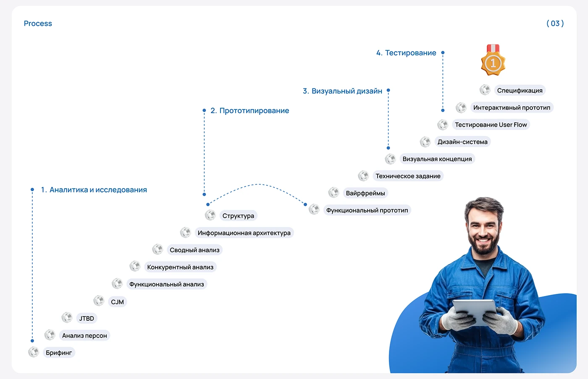

# Four-phase process staircase of pills with nut bullets, dotted connectors and a smiling worker cutout

**Discipline:** web ·  · **Design style:** Photographic & Cinematic
**Tags:** process, staircase, blue, white, pills, industrial, dotted-lines, cyrillic

## What it is
A white rounded slide '(03) Process' with four blue phase headings on dotted vertical lines and a descending and ascending staircase of grey pills each with a metal nut icon (briefing, personas, JTBD, CJM, analyses, structure, wireframes, spec, design system, testing), plus a gold medal and a smiling worker in blue overalls with a tablet on a blue blob.

## What it means
Clear and witty; nuts as bullets fit the metal industry.

## Techniques
- Show steps as a staircase of pills.
- Use a themed bullet (nut).
- Connect phases with dotted lines and an arc.
- Add a cutout character on a blob.

## Best for
- Process and method slides
- Industry-themed case studies
- Long lists organised into phases

## Vocabulary
- **Pill staircase** — Pills stepped diagonally in sequence.
- **Themed bullet** — A list icon related to the subject.
- **Phase marker** — A dotted line with a numbered heading.
- **Character blob** — A colour blob behind a cutout person.
